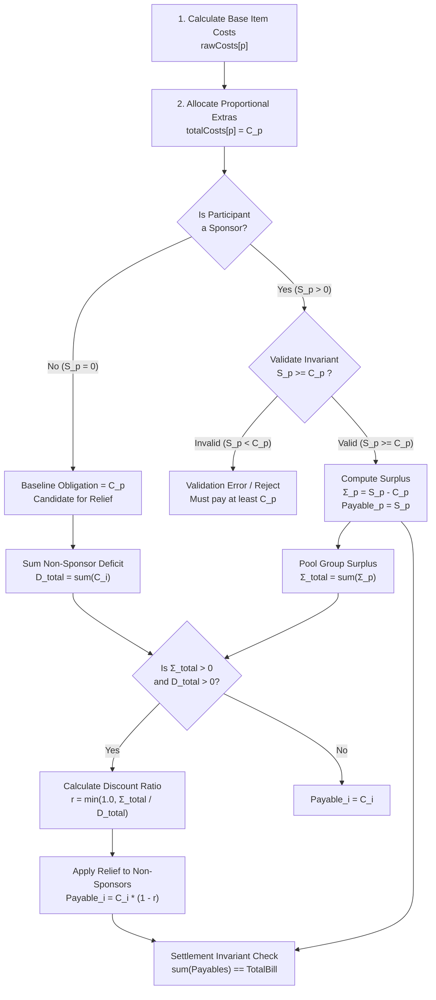

# Specification: Sponsor Mechanism in Ledger

> **Document Type**: Domain Architecture & Mathematical Specification  
> **Target System**: Ledger Expense Engine (`src/hooks/useBillState.ts`, `src/store/useBillStore.ts`, UI Components)  
> **Status**: Official Specification  
> **Date**: October 2026  

---

## 1. Executive Definition: What Does "Sponsor" Mean?

In group expense management, a **Sponsor** is a participant who **voluntarily commits to paying more than their required consumption share**, generating a financial surplus that directly reduces the payment obligations of other participants.

```
                  ┌─────────────────────────────────────────────────────────┐
                  │                    SPONSOR PLEDGE                       │
                  │   Sponsor Amount (S) >= Baseline Consumption Cost (C)   │
                  └────────────────────────────┬────────────────────────────┘
                                               │
                       ┌───────────────────────┴───────────────────────┐
                       ▼                                               ▼
         ┌───────────────────────────┐                   ┌───────────────────────────┐
         │     SELF-CONSUMPTION      │                   │     SURPLUS SUBSIDY       │
         │  Covers own meal & extras │                   │   Pool distributed to     │
         │           (C_p)           │                   │     reduce group debt     │
         └───────────────────────────┘                   │      Σ_p = S_p - C_p      │
                                                         └─────────────┬─────────────┘
                                                                       ▼
                                                         ┌───────────────────────────┐
                                                         │   OTHER PARTICIPANTS      │
                                                         │   Pay LESS than their     │
                                                         │   original baseline share │
                                                         └───────────────────────────┘
```

### Core Axioms
1. **No Negative Sponsorship**: A participant **cannot** sponsor an amount lower than what they consumed. Paying less than one's consumption share is an *underpayment* or *subsidy request*, never a sponsorship.
2. **Strict Minimum Invariant**: For any participant `p` designated as a sponsor:
   ```text
   S_p ≥ C_p
   ```
   where `C_p` is their baseline required payment (items consumed + proportional taxes/fees) and `S_p` is their pledged sponsor amount.
3. **Surplus Generation**: The net contribution to the group is strictly:
   ```text
   Σ_p = S_p - C_p ≥ 0
   ```
4. **Absolute Liability Cap (Nothing More to Pay)**:
   Because the sponsor voluntarily pays more than required (`S_p ≥ C_p`), their total obligation is **strictly capped at `S_p`**.
   - Their consumption share `C_p` is already fully subsumed within `S_p`:
     ```text
     FinalPayable_p = S_p = C_p + Σ_p
     ```
   - A sponsor is **never** billed their meal cost on top of their pledge (`C_p + S_p` is prohibited).
   - A sponsor can **never be required to pay anything more**—they are immune to other participants' underpayments, unassigned item residuals, or host discrepancy deductions.
   - Once `S_p` is settled, their remaining balance is exactly `0`.
5. **Equitable Relief Distribution (Equal Per-Capita Allocation)**:
   The pooled surplus `Σ_total = sum(Σ_p)` is distributed **equally** among all non-sponsoring beneficiaries (`Σ_total / N`). Every guest receives an identical dollar relief, ensuring fairness rather than rewarding those who ordered more expensive items. (Capped so no participant's payable drops below zero).
6. **Multi-Sponsor Support**: Any number of participants can act as sponsors simultaneously. Their surpluses pool together to relieve non-sponsors, while each sponsor's liability remains independently capped at their own pledge.
7. **Conservation of Money (Zero-Sum Settlement)**:
   ```text
   sum(FinalPayable_p) == TotalBill
   ```
   The sponsor's generosity does **not** create phantom money or leave the Host holding unpaid debt.

---

## 2. Analysis of the Flawed Legacy Implementation

To understand why the system previously behaved unexpectedly, consider the legacy logic found in [`useBillState.ts`](file:///home/mudoker/mudoker/projects/ledger/src/hooks/useBillState.ts#L100-L171):

### Flaw 1: Sponsoring Less Than Cost Treated as a Personal Voucher
In the legacy code:
```typescript
// LEGACY CODE (FLAWED)
const diff = cost - sponsor;
if (diff <= 0) {
    finalPayables[p.id] = 0;
    totalSurplus += Math.abs(diff);
} else {
    finalPayables[p.id] = diff; // Allowed sponsor < cost!
    totalDeficitAmount += diff;
}
```
If Bob consumed 100 USD and entered `sponsorAmount = 40`, the legacy engine computed `diff = 100 - 40 = 60`. Bob's payable was cut to 60 USD, giving him a 40 USD private discount while creating 0 USD surplus for the group. Bob claimed to be a "sponsor," but was actually receiving an unauthorized personal handout.

### Flaw 2: The Host Secretly Funded the "Sponsor"
In the legacy settlement step:
```typescript
// LEGACY CODE (FLAWED)
const totalNetPayable = Object.values(finalPayables).reduce((acc, val) => acc + val, 0);
discrepancy = totalPaidInBill - totalNetPayable;

if (discrepancy > 0.01 && hostId) {
    effectivePaidAmounts[hostId] -= discrepancy; // Host absorbs the entire gap!
}
```
If Charlie "sponsored" 150 USD with `paidAmount = 0`, the group enjoyed discounts, but the restaurant still had to be paid. Because the Host is assumed to settle the venue's bill, the engine deducted the entire 150 USD gap from the Host's recoverable balance. The Host paid the restaurant, collected nothing for that 150 USD, and bore the entire financial hit while Charlie got public credit for being generous without spending a single cent.

### Flaw 3: Double-Crediting Caused Reverse Reimbursement
If Charlie entered both `sponsorAmount = 150` and `paidAmount = 150`, the settlement engine saw Charlie's payable as 0 and paid amount as 150. Charlie was classified as an overpaying creditor. In the final settlement, **the Host was instructed to transfer 150 USD back to Charlie**. Charlie ate for free, got reimbursed 150 USD, and the Host lost twice over.

---

## 3. Mathematical Specification of the Correct Mechanism



### Stage 1: Baseline Consumption Liability (`C_p`)
For each participant `p`, calculate their baseline consumption cost:
```text
C_p = rawCosts[p] + totalExtras × (rawCosts[p] / sum(rawCosts))
```
This represents what person `p` must pay if no sponsorship existed.

### Stage 2: Sponsor Invariant & Individual Surplus (Single or Multiple Sponsors)
Let `S_p` denote the sponsor pledge for participant `p`.
Define the Sponsor Cohort as all participants who have pledged a sponsorship:
```text
Sponsors = { p | S_p > 0 }
```

For every sponsor `p ∈ Sponsors`:
1. **Validation Requirement (Strict Floor)**:
   ```text
   S_p ≥ C_p
   ```
   *(If `S_p < C_p`, the system rejects the pledge with a validation error: a sponsor must at least cover their own consumption).*
2. **Individual Surplus Contribution (`Σ_p`)**:
   ```text
   Σ_p = S_p - C_p ≥ 0
   ```
3. **Absolute Liability Cap (Nothing More to Pay)**:
   ```text
   FinalPayable_p = S_p
   ```
   > [!IMPORTANT]
   > **Sponsor Protection Guarantee**:
   > Because the sponsor voluntarily commits to paying more than required, their payment obligation is strictly capped at `S_p`.
   > - Their meal cost `C_p` is already inside `S_p`. They are **never** billed `C_p + S_p`.
   > - They are **never** charged for unallocated item residuals, other guests underpaying, or additional fees.
   > - Once `S_p` is satisfied (either disbursed upfront or settled after), their liability is 100% complete and they owe nothing more.

### Stage 3: Multi-Sponsor Surplus Pooling & Relief Distribution
When multiple participants sponsor simultaneously, their surplus contributions pool together into a single unified relief fund:
```text
Σ_total = sum(Σ_p across all p ∈ Sponsors)
```

Define the non-sponsor Beneficiary Cohort as all participants who are not sponsors and have positive baseline obligations:
```text
Beneficiaries = { i | S_i == 0 and C_i > 0 }
D_total = sum(C_i across all i ∈ Beneficiaries)
```

> [!NOTE]
> **Sponsor Independence Principle**:
> Sponsors do **not** receive subsidies from other sponsors. If Charlie sponsors and Elena also sponsors, Charlie's surplus does not discount Elena, nor does Elena's surplus discount Charlie. Both sponsors have explicitly chosen to contribute fixed total amounts `S_Charlie` and `S_Elena`. The pooled surplus `Σ_total` is directed entirely to relieve the non-sponsoring guests (`Beneficiaries`).

Depending on the ratio between `Σ_total` and `D_total`:

#### Regime A: Partial Group Relief (`Σ_total < D_total`)
The pooled surplus is distributed **equally** among all non-sponsoring beneficiaries (`Beneficiaries`) using the Hamilton integer method with equal weights (`weight = 1n`):
```text
N_beneficiaries = count(Beneficiaries)
EqualRelief_i = HamiltonAllocate(Σ_total, { i: 1n for all i in Beneficiaries })[i]

FinalPayable_i = max(0, C_i - EqualRelief_i)
```

> [!TIP]
> **Why Equal Relief is More Equitable**:
> - Under a percentage-based discount, a participant who ordered an expensive 1,000,000 ₫ steak receives 416,667 ₫ of the sponsor's money, while a guest who ordered a modest 600,000 ₫ dish only gets 250,000 ₫.
> - Under **Equal Per-Capita Relief**, the sponsor's contribution is divided evenly: every single non-sponsor receives the **exact same dollar reduction**, treating all friends equally.

**Capping & Cascade Invariant**:
If any guest's baseline cost `C_i` is less than their equal share `EqualRelief_i` (e.g. they only ordered a small side dish), their relief is capped at `C_i` so their final payable is `0` (no negative payables). Any unabsorbed residual relief cascades and is distributed equally among the remaining non-sponsors whose balances are still positive.

#### Regime B: Total Coverage & Multi-Sponsor Oversubsidy (`Σ_total ≥ D_total`)
When pooled sponsorships equal or exceed total non-sponsor debt:
1. Every non-sponsor is 100% relieved:
   ```text
   FinalPayable_i = 0    (for all i ∈ Beneficiaries)
   ```
2. Any excess surplus `Σ_excess = Σ_total - D_total > 0` is **refunded pro-rata to the contributing sponsors** based on their individual surplus contributions `Σ_p`:
   ```text
   SponsorRefund_p = HamiltonAllocate(Σ_excess, { p: Σ_p })[p]

   FinalPayable_p = S_p - SponsorRefund_p
   ```
   *Result*: In an oversubsidy, sponsors share the savings fairly and pay even *less* than their pledge. Under no circumstances do they ever pay more!

---

## 4. Cash Flow, Net Balance & Settlement Invariants

To avoid the legacy bug where the Host was stuck paying for sponsors, liability and settlement must be strictly separated into **What You Owe (Liability)** vs. **What You Disbursed (Payment Credit)**.

### Monetary Conservation Invariant
The sum of final payables must strictly equal the total bill:
```text
sum(FinalPayable_p across all participants) == TotalBill
```

> [!NOTE]
> **Proof of Conservation**:
> ```text
> Total Payables = sum(FinalPayable_p for sponsors) + sum(FinalPayable_i for beneficiaries)
>                = sum(C_p + Σ_p) + sum(C_i - Relief_i)
>                = sum(C_p) + Σ_total + sum(C_i) - sum(Relief_i)
>                = sum(C_p) + Σ_total + D_total - Σ_total
>                = sum(C_all)
>                = TotalBill
> ```

### Settlement Balances
Let `Paid_p` denote the actual money disbursed directly by person `p` (e.g. paying the merchant or advancing cash):
```text
Balance_p = Paid_p - FinalPayable_p

sum(Balance_p across all participants) == 0
```

* `Balance_p > 0`: **Creditor** (person paid more than their final commitment → receives refund).
* `Balance_p < 0`: **Debtor** (person paid less than their final commitment → pays into settlement).
* `Balance_p == 0`: **Settled** (no further transfers required).

---

## 5. Concrete Numerical Walkthroughs

### Example 1: Standard Sponsorship (`S_p ≥ C_p`)
* **Scenario**: Dinner bill is **2,000,000 ₫**.
  * **Alex (Host)**: Consumes 500,000 ₫. Pays the 2,000,000 ₫ restaurant bill upfront.
  * **Bob**: Consumes 500,000 ₫.
  * **David**: Consumes 500,000 ₫.
  * **Charlie (Sponsor)**: Consumes 500,000 ₫. Charlie generously pledges a sponsor amount of **800,000 ₫**.

#### Step-by-Step Calculation:
1. **Baselines**:
   * `C_Alex = 500,000 ₫`
   * `C_Bob = 500,000 ₫`
   * `C_David = 500,000 ₫`
   * `C_Charlie = 500,000 ₫`
2. **Sponsor Validation**:
   Charlie's `S_Charlie = 800,000 ₫ ≥ 500,000 ₫` → **Valid!**
   * Charlie's surplus contribution:
     `Σ_Charlie = 800,000 ₫ - 500,000 ₫ = 300,000 ₫`
   * Charlie's final payable:
     `FinalPayable_Charlie = 800,000 ₫`
3. **Beneficiary Relief**:
   Beneficiaries = `{Alex, Bob, David}`.
   * Total non-sponsor demand: `D_total = 1,500,000 ₫`.
   * Discount ratio:
     `r = 300,000 ₫ / 1,500,000 ₫ = 20%`
   * Beneficiary payables:
     * `FinalPayable_Alex = 500,000 ₫ × (1 - 0.20) = 400,000 ₫`
     * `FinalPayable_Bob = 500,000 ₫ × (1 - 0.20) = 400,000 ₫`
     * `FinalPayable_David = 500,000 ₫ × (1 - 0.20) = 400,000 ₫`
4. **Verification**:
   `Sum = 800,000 + 400,000 + 400,000 + 400,000 = 2,000,000 ₫` (Exact!)
5. **Settlement**:
   * Alex paid 2,000,000 ₫ upfront to the venue. Alex owes 400,000 ₫ → `Balance = +1,600,000 ₫` (receives 1.6M).
   * Bob owes 400,000 ₫ → pays Alex 400,000 ₫.
   * David owes 400,000 ₫ → pays Alex 400,000 ₫.
   * Charlie owes 800,000 ₫ → pays Alex 800,000 ₫.
   * Alex receives: `400k + 400k + 800k = 1,600,000 ₫`.
   * **Outcome**: Charlie paid 800,000 ₫ as pledged. Alex, Bob, and David each saved 100,000 ₫ (paying 400k instead of 500k). Alex recovered 100% of upfront money.

---

### Example 2: Invalid Under-Sponsorship Attempt (`S_p < C_p`)
* **Scenario**:
  * Eve consumes **300,000 ₫** of sushi.
  * Eve enters `sponsorAmount = 100,000 ₫`.
* **Engine Evaluation**:
  `S_Eve (100,000 ₫) < C_Eve (300,000 ₫)`
* **Result**: **Validation Rejection**.
  The UI displays an inline warning:
  > *"Sponsor amount must be at least your baseline share of 300,000 ₫. To provide a group subsidy, enter an amount greater than 300,000 ₫."*
  Eve cannot use the sponsor field to self-discount her own dinner.

---

### Example 3: Multi-Sponsor Walkthrough (Multiple Sponsors in the Same Session)
* **Scenario**: Total group bill is **4,000,000 ₫**.
  * **Alex (Host)**: Consumes 600,000 ₫. Pays the entire 4,000,000 ₫ bill upfront to the venue.
  * **Bob**: Consumes 800,000 ₫ (non-sponsor).
  * **David**: Consumes 1,000,000 ₫ (non-sponsor).
  * **Charlie (Sponsor 1)**: Consumes 600,000 ₫. Pledges `S_Charlie = 1,000,000 ₫`.
  * **Elena (Sponsor 2)**: Consumes 1,000,000 ₫. Pledges `S_Elena = 1,600,000 ₫`.

#### Step-by-Step Multi-Sponsor Calculation:
1. **Validate & Cap Sponsor Liabilities**:
   * Charlie: `S_Charlie = 1,000,000 ₫ ≥ 600,000 ₫` → **Valid!**
     * Surplus generated: `Σ_Charlie = 1,000,000 ₫ - 600,000 ₫ = 400,000 ₫`
     * Final Payable: `FinalPayable_Charlie = 1,000,000 ₫` (capped, owes nothing more).
   * Elena: `S_Elena = 1,600,000 ₫ ≥ 1,000,000 ₫` → **Valid!**
     * Surplus generated: `Σ_Elena = 1,600,000 ₫ - 1,000,000 ₫ = 600,000 ₫`
     * Final Payable: `FinalPayable_Elena = 1,600,000 ₫` (capped, owes nothing more).

2. **Pool the Group Surplus**:
   `Σ_total = Σ_Charlie + Σ_Elena = 400,000 ₫ + 600,000 ₫ = 1,000,000 ₫`

3. **Identify Beneficiaries & Distribute Equitable Equal Relief**:
   Beneficiaries = `{Alex, Bob, David}` (non-sponsors, `N = 3`).
   * Total non-sponsor baseline debt:
     `D_total = 600,000 ₫ + 800,000 ₫ + 1,000,000 ₫ = 2,400,000 ₫`
   * Distribute the `1,000,000 ₫` surplus **equally** using integer Hamilton allocation (`weight = 1n` for each):
     * Alex: receives **333,334 ₫** relief → `FinalPayable_Alex = 600,000 ₫ - 333,334 ₫ = 266,666 ₫`
     * Bob: receives **333,333 ₫** relief → `FinalPayable_Bob = 800,000 ₫ - 333,333 ₫ = 466,667 ₫`
     * David: receives **333,333 ₫** relief → `FinalPayable_David = 1,000,000 ₫ - 333,333 ₫ = 666,667 ₫`
   * Total relief applied: `333,334 + 333,333 + 333,333 = 1,000,000 ₫`.
   *(Notice: Every friend receives an identical ~333,333 ₫ reduction from the sponsors' gift, ensuring pure fairness).*

4. **Conservation Verification**:
   `Charlie (1,000,000) + Elena (1,600,000) + Alex (266,666) + Bob (466,667) + David (666,667) = 4,000,000 ₫` (Exact!)

5. **Settlement Transfers**:
   * Charlie pays Alex: **1,000,000 ₫**
   * Elena pays Alex: **1,600,000 ₫**
   * Bob pays Alex: **466,667 ₫**
   * David pays Alex: **666,667 ₫**
   * Alex collects: `1,000,000 + 1,600,000 + 466,667 + 666,667 = 3,733,334 ₫`.
   * Alex's net expense: `4,000,000 ₫ (paid to venue) - 3,733,334 ₫ (collected) = 266,666 ₫` (matches Alex's discounted final payable).
   * **Result**:
     - Charlie paid 1,000,000 ₫ and **owes nothing more**.
     - Elena paid 1,600,000 ₫ and **owes nothing more**.
     - Alex, Bob, and David each saved the exact same 333,333 ₫.
     - Zero unallocated debt; 100% balanced.

---

## 6. Implementation & UI/UX Guidelines

### 1. Two Intuitive UI Input Modes
When allowing users to sponsor, offer two clear modes in the participant drawer or modal:

* **Mode A: "Total Pledge" (`S_p`)**
  * Label: *"Total amount I want to contribute"*
  * Input minimum: Pre-filled or constrained to `C_p`.
  * Helper note: *"Covers your 320,000 ₫ share + provides (Input - 320,000 ₫) group discount."*

* **Mode B: "Additive Subsidy" (`Δ_p`)**
  * Label: *"Extra group subsidy on top of my share"*
  * Input value: `Δ_p ≥ 0`.
  * Total payable automatically computes as: `S_p = C_p + Δ_p`.

### 2. Summary Table Visual Representation
The splits summary table should clearly show the progression:

| Participant | Consumption (`C_p`) | Sponsor Pledge (`S_p`) | Subsidy / Discount | Final Payable |
| :--- | :---: | :---: | :---: | :---: |
| **Charlie (Sponsor)** | 500,000 ₫ | 800,000 ₫ | `+300,000 ₫ (Pledged)` | **800,000 ₫** |
| **Alex (Host)** | 500,000 ₫ | — | `-100,000 ₫ (-20%)` | **400,000 ₫** |
| **Bob** | 500,000 ₫ | — | `-100,000 ₫ (-20%)` | **400,000 ₫** |
| **David** | 500,000 ₫ | — | `-100,000 ₫ (-20%)` | **400,000 ₫** |
| **TOTAL** | **2,000,000 ₫** | **800,000 ₫** | **Net Zero (Balanced)** | **2,000,000 ₫** |

---

## 7. Relationship to Multi-Payer Architecture

In the upcoming Multi-Payer Architecture documented in [`MULTIPLE_PAYERS_PLAN.md`](file:///home/mudoker/mudoker/projects/ledger/MULTIPLE_PAYERS_PLAN.md):
1. **Direct Item Sponsorship**: If a participant wants to sponsor a specific item (e.g. Charlie pays for the 1,200,000 ₫ Wagyu beef so everyone else eats it for free), Charlie simply registers as the 100% payer for that item while adding everyone else as consumers.
2. **Bill-Wide Sponsorship**: Uses the mathematical formulation defined in Section 3 of this document.

By formalizing the rule that **Sponsor Amount ≥ Consumption Share**, Ledger guarantees that sponsoring always means giving to the group, never offloading debt onto the Host.
