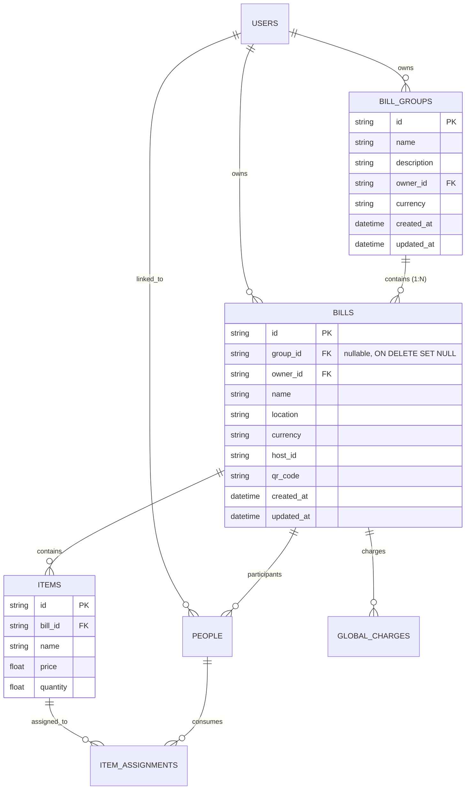
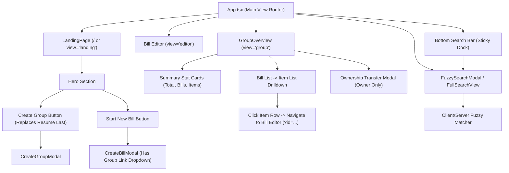

# Architecture & Implementation Plan: Bill Groups, Overview Aggregation & Fuzzy Search

> **Document Type**: Technical Specification & Implementation Plan  
> **Status**: Implementation-Ready Final Specification (Planning Mode)  
> **Target Version**: Ledger 2.2  
> **Author**: Antigravity Assistant  
> **Date**: October 2026  

---

## 1. Executive Summary & Problem Statement

Currently, **Ledger** functions primarily around standalone, independent bills (`bills` table). Each bill represents a single outing, dinner, or event. However, real-world expense management often spans **multi-event activities**:
- **Vacations & Road Trips**: A 4-day trip to Da Nang involves 12 separate bills (hotel, flights, multiple meals, taxi rides, museum tickets).
- **Hackathons & Conferences**: Multiple days of group food, Uber rides, grocery runs, and equipment purchases.
- **Shared Living / Roommates**: Monthly recurring bills (groceries, internet, electricity, shared household supplies).

Users currently must track each bill separately, lacking a unified view of total expenditure across an entire group trip or project.

### Core Goals
1. **Bill Groups (`bill_groups`)**: Create a named container grouping multiple bills together (e.g., *"Da Nang Trip 2026"*).
2. **Aggregated Overview (Group -> Bill -> Items)**:
   - High-level financial overview aggregating total group spend, bill count, and total items.
   - Clean hierarchical drill-down showing each bill and its constituent items.
   - **No sponsor or complex adjustment clutter**: Per user requirements, sponsor mechanisms and fine-grained payer splits belong inside each sub-bill. The group view is an elegant, uncluttered financial overview.
3. **Interactive Navigation**: Clicking on any item or bill row in the group overview navigates directly to that bill's editor page.
4. **Unified Owner-Only Administration with Ownership Transfer (Groups & Bills)**:
   - **For Bill Groups**: Only the group owner can edit group details (name, description, currency), link/unlink bills, delete the group, or transfer ownership.
   - **For Individual Bills**: Only the bill owner can edit bill details (name, location, currency, QR code), modify items, assign participants, configure global charges, delete the bill, assign/unlink it to a group, or transfer ownership.
   - **Secure Ownership Transfer**: Both bill groups and individual bills feature a transferable ownership mechanism allowing the current owner to securely reassign full ownership to any verified, registered user. Previous owners retain participant status (preserving their historical spending and item assignments) while administrative rights transfer to the new owner. Non-owners on both entities have strictly enforced read-only access.
5. **No Realtime Editing Overhead**:
   - Strict adherence to RESTful HTTP endpoints with optimistic/debounced UI updates. No WebSockets, CRDTs, or live-cursor infrastructure.
6. **Mandatory/Prompted Group Linkage**:
   - Every bill creation flow (`CreateBillModal`) prompts the user to associate the bill with an existing or new group (with an option to keep it standalone).
   - Bill settings page (`BillConfiguration`) allows reassigning or unlinking the bill's group at any time.
7. **Bottom Search Bar with Real-Time Fuzzy Search**:
   - Omnipresent bottom search trigger on mobile and desktop landing views.
   - Fast fuzzy matching across groups, bills, and line items with categorized, clickable results.
8. **Landing Page CTA Update**:
   - Replace the legacy *"Resume Last"* button with a prominent *"Create Group"* button triggering a `CreateGroupModal`.

---

## 2. Architecture & Domain Model



### Hierarchy of Data Aggregation

```
┌────────────────────────────────────────────────────────────────────────┐
│                        BILL GROUP: "Da Nang Trip"                      │
│   Owner: Alice | Currency: VND | Total: 14,850,000₫ | 4 Bills | 18 Items │
└───────────────────────────────────┬────────────────────────────────────┘
                                    │
         ┌──────────────────────────┴──────────────────────────┐
         ▼                                                     ▼
┌───────────────────────────────┐             ┌───────────────────────────────┐
│ Bill 1: Seafood Dinner        │             │ Bill 2: Grab to Ba Na Hills   │
│ Venue: Be Man, D1             │             │ Total: 450,000₫ (2 items)     │
│ Total: 3,200,000₫ (6 items)   │             │                               │
├───────────────────────────────┤             ├───────────────────────────────┤
│ • Steamed Crabs (2kg)  1,600k │             │ • GrabCar 7-seater     380k   │
│ • Grilled Squid (1kg)    480k │             │ • Toll Fee              70k   │
│ • Fried Rice             120k │             └───────────────┬───────────────┘
│ [Click item -> navigates]     │                             │ [Click item -> navigates]
└───────────────┬───────────────┘                             ▼
                └─────────────────────────────► Opens Bill Editor (?id=bill_2)
```

---

## 3. Database Schema & Migration Strategy

Both **SQLite** (`db/sqlite.ts`) and **PostgreSQL/Neon** (`db/postgres.ts`) must be updated synchronously to preserve local and production parity.

### 3.1 SQLite Schema Changes (`db/sqlite.ts`)

```sql
-- 1. Create bill_groups table
CREATE TABLE IF NOT EXISTS bill_groups (
  id TEXT PRIMARY KEY,
  name TEXT NOT NULL,
  description TEXT,
  owner_id TEXT NOT NULL,
  currency TEXT DEFAULT 'VND',
  created_at DATETIME DEFAULT CURRENT_TIMESTAMP,
  updated_at DATETIME DEFAULT CURRENT_TIMESTAMP,
  FOREIGN KEY(owner_id) REFERENCES users(id) ON DELETE CASCADE
);

-- Index for fast user group lookups
CREATE INDEX IF NOT EXISTS idx_bill_groups_owner ON bill_groups(owner_id);

-- 2. Add group_id to bills table if not present
-- Executed inside SqliteAdapter.init()
ALTER TABLE bills ADD COLUMN group_id TEXT REFERENCES bill_groups(id) ON DELETE SET NULL;
CREATE INDEX IF NOT EXISTS idx_bills_group_id ON bills(group_id);
```

#### Safe Migration Logic in `SqliteAdapter.init()`:
```typescript
const billCols = this.db.prepare("PRAGMA table_info(bills)").all() as Array<{ name: string }>;
const billColNames = new Set(billCols.map(c => c.name));
if (!billColNames.has('group_id')) {
  this.db.exec('ALTER TABLE bills ADD COLUMN group_id TEXT REFERENCES bill_groups(id) ON DELETE SET NULL;');
  this.db.exec('CREATE INDEX IF NOT EXISTS idx_bills_group_id ON bills(group_id);');
}
```

---

### 3.2 PostgreSQL / Neon Schema Changes (`db/postgres.ts`)

```sql
-- 1. Create bill_groups table
CREATE TABLE IF NOT EXISTS bill_groups (
  id TEXT PRIMARY KEY,
  name TEXT NOT NULL,
  description TEXT,
  owner_id TEXT NOT NULL REFERENCES users(id) ON DELETE CASCADE,
  currency TEXT DEFAULT 'VND',
  created_at TIMESTAMPTZ DEFAULT CURRENT_TIMESTAMP,
  updated_at TIMESTAMPTZ DEFAULT CURRENT_TIMESTAMP
);

CREATE INDEX IF NOT EXISTS idx_bill_groups_owner ON bill_groups(owner_id);

-- 2. Add group_id to bills table if not present
DO $$
BEGIN
  IF NOT EXISTS (
    SELECT 1 FROM information_schema.columns 
    WHERE table_name = 'bills' AND column_name = 'group_id'
  ) THEN
    ALTER TABLE bills ADD COLUMN group_id TEXT REFERENCES bill_groups(id) ON DELETE SET NULL;
    CREATE INDEX idx_bills_group_id ON bills(group_id);
  END IF;
END $$;
```

---

### 3.3 TypeScript Data Contracts (`db/types.ts`)

```typescript
export interface BillGroupRow {
  id: string;
  name: string;
  description: string | null;
  owner_id: string;
  currency: string;
  created_at: string;
  updated_at: string;
}

export interface BillGroupSummary {
  id: string;
  name: string;
  description: string | null;
  owner_id: string;
  owner_name?: string | null;
  owner_email?: string | null;
  is_owner: boolean;
  currency: string;
  total_amount: number;
  total_bills: number;
  total_items: number;
  created_at: string;
  updated_at: string;
}

export interface GroupItemOverview {
  id: string;
  name: string;
  price: number;
  quantity: number;
  total_price: number;
}

export interface GroupBillOverview {
  id: string;
  name: string;
  location: string | null;
  currency: string;
  total_amount: number;
  created_at: string;
  updated_at: string;
  items: GroupItemOverview[];
}

export interface BillGroupDetail {
  id: string;
  name: string;
  description: string | null;
  owner_id: string;
  owner_name?: string | null;
  owner_email?: string | null;
  is_owner: boolean;
  currency: string;
  total_amount: number;
  total_bills: number;
  total_items: number;
  created_at: string;
  updated_at: string;
  bills: GroupBillOverview[];
}
```

---

## 4. API Specifications & Access Control

### 4.1 Endpoints Summary

| Method | Endpoint | Description | Auth Required | Permissions |
|---|---|---|---|---|
| `GET` | `/api/groups` | List user's groups (owned or containing user's bills) | Yes | Authenticated |
| `POST` | `/api/groups` | Create new group | Yes | Authenticated |
| `GET` | `/api/groups/[id]` | Get aggregated group overview (bills + items) | Optional / Yes | Public share or Participant/Owner |
| `PUT` | `/api/groups/[id]` | Update group metadata (name, description, currency) | Yes | **Group Owner Only** |
| `DELETE` | `/api/groups/[id]` | Delete group (unlinks all bills; does not delete bills) | Yes | **Group Owner Only** |
| `POST` | `/api/groups/[id]/transfer` | Transfer group ownership to new user | Yes | **Group Owner Only** |
| `POST` | `/api/groups/[id]/bills` | Link or unlink bills to/from group | Yes | **Group Owner Only** |
| `POST` | `/api/bills` | Create or update bill (save items, charges, people) | Yes | **Bill Owner Only** (for updates) |
| `DELETE` | `/api/bills/[id]` | Delete bill | Yes | **Bill Owner Only** |
| `POST` | `/api/bills/[id]/transfer` | Transfer bill ownership to new user | Yes | **Bill Owner Only** |
| `GET` | `/api/search` | Search bills, groups, and items (Fuzzy match) | Yes | Authenticated |

---

### 4.2 Endpoint Specifications

#### `POST /api/groups`
- **Request Body**:
  ```json
  {
    "name": "Da Nang Holiday 2026",
    "description": "4-day company retreat expenses",
    "currency": "VND"
  }
  ```
- **Response `201 Created`**:
  ```json
  {
    "id": "grp_8f9c1e...",
    "name": "Da Nang Holiday 2026",
    "description": "4-day company retreat expenses",
    "owner_id": "usr_123...",
    "currency": "VND",
    "created_at": "2026-10-25T14:00:00Z"
  }
  ```

#### `GET /api/groups/[id]`
- **Response `200 OK`**:
  ```json
  {
    "id": "grp_8f9c1e...",
    "name": "Da Nang Holiday 2026",
    "description": "4-day company retreat expenses",
    "owner_id": "usr_123...",
    "owner_name": "Alice Nguyen",
    "owner_email": "alice@example.com",
    "is_owner": true,
    "currency": "VND",
    "total_amount": 14850000,
    "total_bills": 3,
    "total_items": 14,
    "created_at": "2026-10-25T10:00:00Z",
    "updated_at": "2026-10-25T16:30:00Z",
    "bills": [
      {
        "id": "bill_998a...",
        "name": "Seafood Dinner",
        "location": "Be Man Restaurant",
        "currency": "VND",
        "total_amount": 3200000,
        "created_at": "2026-10-25T12:00:00Z",
        "updated_at": "2026-10-25T13:00:00Z",
        "items": [
          {
            "id": "item_11",
            "name": "Steamed Sea Crab",
            "price": 800000,
            "quantity": 2,
            "total_price": 1600000
          },
          {
            "id": "item_12",
            "name": "Fried Baby Squid",
            "price": 480000,
            "quantity": 1,
            "total_price": 480000
          }
        ]
      }
    ]
  }
  ```

#### `POST /api/groups/[id]/transfer`
- **Request Body**:
  ```json
  {
    "new_owner_id": "usr_789abc..."
  }
  ```
- **Permission Check**: Must verify `sessionUser.id === group.owner_id`.
- **Validation**: Verify that `new_owner_id` exists in `users` table.
- **Execution**: Updates `bill_groups.owner_id = new_owner_id`, sets `updated_at = CURRENT_TIMESTAMP`.
- **Response `200 OK`**:
  ```json
  {
    "success": true,
    "group_id": "grp_8f9c1e...",
    "previous_owner_id": "usr_123...",
    "new_owner_id": "usr_789abc..."
  }
  ```

#### `POST /api/bills/[id]/transfer`
- **Request Body**:
  ```json
  {
    "new_owner_id": "usr_789abc..."
  }
  ```
- **Permission Check**: Must verify `sessionUser.id === bill.owner_id`. Non-owners receive `403 Forbidden`.
- **Validation**: Verify that `new_owner_id` exists in `users` table.
- **Execution**:
  1. Updates `bills.owner_id = new_owner_id`, sets `bills.updated_at = CURRENT_TIMESTAMP`.
  2. Ensures the new owner exists in the `people` table for this bill:
     - If the new owner's `user_id` or `email` already exists in `people`, links `user_id` to `new_owner_id`.
     - If not already present, creates a person record for the new owner so they appear in participant selections and can be assigned items.
  3. The previous owner remains in the `people` table as a participant with their historical paid amounts and item assignments fully preserved, but their role is now `participant` (read-only; editing is locked).
- **Response `200 OK`**:
  ```json
  {
    "success": true,
    "bill_id": "bill_998a...",
    "previous_owner_id": "usr_123...",
    "new_owner_id": "usr_789abc..."
  }
  ```

#### `GET /api/search?q=query`
- **Query Params**: `q` (string, minimum 1 character).
- **Behavior**: Fuzzy search across Bills (name, location, item names) and Groups (name, description).
- **Response `200 OK`**:
  ```json
  {
    "results": {
      "groups": [
        {
          "id": "grp_8f9c1e...",
          "name": "Da Nang Holiday 2026",
          "match_field": "name",
          "total_amount": 14850000,
          "total_bills": 3
        }
      ],
      "bills": [
        {
          "id": "bill_998a...",
          "name": "Seafood Dinner",
          "group_name": "Da Nang Holiday 2026",
          "group_id": "grp_8f9c1e...",
          "location": "Be Man Restaurant",
          "total_amount": 3200000
        }
      ],
      "items": [
        {
          "id": "item_11",
          "name": "Steamed Sea Crab",
          "price": 800000,
          "bill_id": "bill_998a...",
          "bill_name": "Seafood Dinner"
        }
      ]
    }
  }
  ```

---

## 5. Frontend Architecture & State Management



### 5.1 New Store: `src/store/useGroupStore.ts`
To keep bill editing decoupled from group management, we introduce a dedicated Zustand store:

```typescript
export interface GroupState {
  groups: BillGroupSummary[];
  currentGroup: BillGroupDetail | null;
  isLoading: boolean;
  error: string | null;

  // Actions
  fetchGroups: () => Promise<void>;
  fetchGroupDetail: (groupId: string) => Promise<void>;
  createGroup: (data: { name: string; description?: string; currency?: string }) => Promise<string>;
  updateGroup: (groupId: string, data: Partial<BillGroupDetail>) => Promise<void>;
  deleteGroup: (groupId: string) => Promise<boolean>;
  transferOwnership: (groupId: string, newOwnerId: string) => Promise<boolean>;
  linkBillToGroup: (billId: string, groupId: string | null) => Promise<void>;
  setCurrentGroup: (group: BillGroupDetail | null) => void;
}
```

### 5.2 Updates to `useBillStore.ts`
- Add `groupId: string | null` to `BillState`.
- Add `setGroupId: (groupId: string | null) => void`.
- Add `transferBillOwnership: (billId: string, newOwnerId: string) => Promise<boolean>` to `BillState`.
- Include `groupId` in payload sent to `saveToDb()`.
- Load `groupId` and `owner_id` into store on `fetchBill()`.
- Enforce strict `isReadOnly` state whenever `user?.id !== owner_id`. Auto-save is disabled when viewing in read-only/participant mode.

---

## 6. Detailed UI & Component Specifications

### 6.1 Landing Page Hero CTA Update
**File**: `src/components/layout/landing-page.tsx`
- Replace `{hasActiveLocalData && <Button>... Resume Last ...</Button>}`:
- **New CTA Layout**:
  ```tsx
  <div className="flex flex-col sm:flex-row gap-2.5 sm:gap-4 justify-center w-full max-w-sm sm:max-w-none">
    {user ? (
      <>
        {/* NEW: Create Group button */}
        <Button
          onClick={() => setIsCreateGroupModalOpen(true)}
          variant="outline"
          size="lg"
          className="h-11 sm:h-14 px-5 sm:px-8 text-sm sm:text-lg font-bold gap-2 rounded-xl sm:rounded-2xl border-2 transition-all hover:bg-foreground/5 w-full sm:w-auto touch-manipulation active:scale-95"
        >
          <FolderPlus className="w-4 h-4 sm:w-6 sm:h-6" /> Create Group
        </Button>

        {/* Existing: Start New Bill */}
        <Button
          onClick={() => setIsCreateModalOpen(true)}
          size="lg"
          className="h-11 sm:h-14 px-5 sm:px-8 text-sm sm:text-lg font-bold gap-2 rounded-xl sm:rounded-2xl shadow-xl shadow-foreground/10 transition-all hover:scale-105 active:scale-95 bg-foreground text-background hover:bg-foreground/90 w-full sm:w-auto touch-manipulation"
        >
          <Plus className="w-4 h-4 sm:w-6 sm:h-6" /> Start New
        </Button>
      </>
    ) : (
      /* Sign in with Google */
      <Button onClick={signInWithGoogle} ...>
        <GoogleIcon ... /> Sign in with Google
      </Button>
    )}
  </div>
  ```
- *Note on Local Drafts*: If a local active bill draft exists, show a non-intrusive banner or small chip above the recent history list (`"You have an unsaved draft bill — Click to resume"`), keeping the main hero CTA cleanly dedicated to **Create Group** and **Start New**.

---

### 6.2 `CreateGroupModal`
**File**: `src/components/shared/create-group-modal.tsx`
- Controlled Dialog built with Radix UI / Shadcn.
- **Fields**:
  - Group Name (`Input`, required, auto-focused).
  - Description / Notes (`Input` or `Textarea`, optional).
  - Default Currency (`CurrencyDropdown`, defaults to VND).
- **Validation**: Name length $\ge 2$ characters.
- **On Submit**:
  1. Calls `createGroup({ name, description, currency })`.
  2. On success, closes modal, refreshes groups, and smoothly switches view to the new group overview (`view = 'group'`, `groupId = newGroup.id`).

---

### 6.3 `CreateBillModal` Group Linker
**File**: `src/components/shared/create-bill-modal.tsx`
- When opening `CreateBillModal`, query user's available groups.
- Add field:
  ```tsx
  <div className="space-y-1 sm:space-y-1.5">
    <Label className="text-xs font-bold uppercase tracking-wider text-foreground flex items-center gap-1.5">
      <Folder className="w-3.5 h-3.5 text-muted-foreground" /> Link to Group (Optional)
    </Label>
    <Select value={selectedGroupId} onValueChange={setSelectedGroupId}>
      <SelectTrigger className="h-9 bg-foreground/[0.03] border-border rounded-xl font-medium text-xs">
        <SelectValue placeholder="No Group (Standalone Bill)" />
      </SelectTrigger>
      <SelectContent>
        <SelectItem value="none">No Group (Standalone Bill)</SelectItem>
        {groups.map(g => (
          <SelectItem key={g.id} value={g.id}>📁 {g.name}</SelectItem>
        ))}
      </SelectContent>
    </Select>
  </div>
  ```
- Pass `groupId: selectedGroupId === 'none' ? null : selectedGroupId` to `onSubmit`.

---

### 6.4 Bill Settings (`BillConfiguration`) Group Linker & Ownership Management
**File**: `src/components/summary/bill-configuration.tsx`
- **Bill Group Assignment Section**:
  - Displays current linked group name with a badge.
  - Dropdown to switch to another group, detach from group ("None"), or click to view the group overview.
  - Automatically auto-saves alongside other bill metadata updates.
- **Bill Ownership Transfer Section (Owner Only)**:
  - Displays the current bill owner badge.
  - Adds a *"Transfer Ownership"* button triggering the universal `TransferOwnershipModal` with `targetType="bill"`.
  - Hidden when viewing in participant or read-only mode.

---

### 6.5 Group Overview View (`GroupOverviewPage`)
**File**: `src/components/groups/group-overview.tsx`
- **Top Bar**:
  - Back Button: Navigates back to Landing.
  - Group Title & Description.
  - Owner Badge: `"Owner: Alice"` or `"You are Owner"`.
  - Actions (Owner Only):
    - Edit metadata (name, description).
    - Transfer Ownership (`<Button variant="outline"><UserCheck /> Transfer</Button>`).
    - Delete Group (`<Button variant="destructive"><Trash2 /></Button>`).
- **Summary Stat Grid**:
  - **Total Spend**: Large formatted currency amount.
  - **Bills Count**: Number of bills.
  - **Items Count**: Total items across all bills.
  - **Date Span**: e.g., *"Oct 21 – Oct 25, 2026"*.
- **Hierarchical Drill-Down (Bills -> Items)**:
  - Rendered as clean cards or an accordion list.
  - **Each Bill Card Header**:
    - Bill Name, Venue/Location, Date, Bill Subtotal.
    - Clickable link: *"Open Bill Editor ↗"*.
  - **Items List within Bill**:
    - Display line items in a crisp table or card list:
      - Item Name
      - Quantity (e.g. `× 2`)
      - Unit Price & Total Price
    - **Interactive Click**: On clicking anywhere on an item row:
      - Navigates immediately to `view = 'editor'` with `?id=${bill.id}`.
      - Smoothly opens that bill's editor.
- **Strict Visual Boundary**:
  - **NO sponsor logic or sponsor relief chips shown in this big view**.
  - **NO payer settlement graphs or hub-spoke vectors shown here**.
  - Clean, unencumbered financial ledger overview.

---

### 6.6 Bottom Search Bar & `FuzzySearchModal`
**File**: `src/components/shared/bottom-search-bar.tsx` & `src/components/shared/fuzzy-search-modal.tsx`

#### UI Placement:
- **Mobile**: A floating pill docked above the safe-area bottom (`bottom-4 left-4 right-4 z-40 fixed`).
- **Desktop**: Centered floating trigger bar or dock (`max-w-md mx-auto fixed bottom-6 inset-x-0 z-40`).
- Features a magnifying glass icon, placeholder `"Search bills, groups & items... (⌘K)"`, and subtle shortcut badge.
- Keyboard shortcut `⌘K` or `Ctrl+K` immediately opens search.

#### Fuzzy Matching Engine:
- Implemented with **Fuse.js** (or an optimized, zero-dependency subsequence Levenshtein matcher):
  ```typescript
  const fuseBills = new Fuse(bills, {
    keys: ['name', 'location', 'items.name'],
    threshold: 0.35, // Balanced fuzzy tolerance
    ignoreLocation: true,
  });

  const fuseGroups = new Fuse(groups, {
    keys: ['name', 'description'],
    threshold: 0.35,
  });
  ```
- **Modal Display**:
  - Clean Radix Dialog with auto-focused input.
  - Grouped results sections:
    - **Bill Groups** (Folder icon, Group Name, Total Bills, Total Spend).
    - **Bills** (Receipt icon, Bill Name, Location, Total Amount, Group Name pill).
    - **Items** (Tag icon, Item Name, Price, Parent Bill name).
  - Keyboard navigation (Up/Down arrow keys, Enter to navigate, Escape to dismiss).
  - Clicking any result instantly routes to the respective group overview or bill editor!

---

### 6.7 Universal Ownership Transfer Modal
**File**: `src/components/shared/transfer-ownership-modal.tsx`
- **Dual-Purpose Design**: Reusable for transferring ownership of **either a Bill Group or an Individual Bill** (`targetType: 'group' | 'bill'`, `targetId: string`, `targetName: string`).
- **Owner-Gated Visibility**: Accessible **strictly** by the current owner (`sessionUser.id === target.owner_id`).
- **User Discovery**:
  - For Bills: Pre-populates bill participants who possess registered user accounts, plus a live search input querying `/api/users/search?q=...`.
  - For Groups: Live search input querying registered users via `/api/users/search?q=...`.
- **Matching Results**: Displays user avatars, names, and verified emails.
- **Confirmation Dialogue & Warning**:
  > **Explicit Safeguard**:  
  > *"You are about to transfer full ownership of this {group | bill} ('{Name}') to {New Owner Name} ({email}).*  
  > *• The new owner will have sole permission to edit details, add/remove items, manage charges, and transfer ownership.*  
  > *• You will remain a participant with your personal records intact, but your role will change to read-only.*  
  > *• This action cannot be undone by you."*
- **API Dispatch**:
  - If `targetType === 'group'`: Calls `POST /api/groups/[id]/transfer`.
  - If `targetType === 'bill'`: Calls `POST /api/bills/[id]/transfer`.
- **State Transition**: Immediately marks the current client session as `role: 'participant'` and `isReadOnly: true`, disabling auto-save mutations and refreshing history.

---

## 7. Edge Cases & Safety Invariants

| Scenario | Handled Invariant |
|---|---|
| **Deleting a Group** | Foreign key on `bills.group_id` is `ON DELETE SET NULL`. Deleting a group **never** deletes its underlying bills; bills are cleanly unlinked and preserved as standalone bills. |
| **Deleting a Bill** | The bill is deleted from `bills`. The group's aggregation automatically reflects the updated total on subsequent queries. Only the bill owner can delete the bill. |
| **Multi-Currency Bills in Group** | When bills inside a group have varying currencies (e.g., USD and VND): The group overview converts bill totals to the group's default currency using central bank rates (`fetchExchangeRate`), displaying the converted group total alongside the original currency for each individual bill. |
| **Non-Owner Attempts Group Modification** | Backend API checks `sessionUser.id === group.owner_id`. If unauthorized, responds with `403 Forbidden` (`"Only the group owner can modify group settings"`). UI hides edit/delete/transfer controls for non-owners. |
| **Non-Owner Attempts Bill Modification** | Backend API checks `sessionUser.id === bill.owner_id`. If unauthorized, responds with `403 Forbidden` (`"Only the bill owner can edit this bill"`). Client enters `isReadOnly = true` mode, preventing any auto-save calls. |
| **Bill Ownership Transfer Invariant** | Transferring bill ownership reassigns `bills.owner_id` to `new_owner_id`. The previous owner remains in `people` to preserve their past payments and item assignments. The new owner is automatically ensured in `people`. |
| **Transferred Owner is Not in System** | Ownership of either a bill or a group can only be transferred to a verified, registered user found via `/api/users/search`. Cannot transfer to unverified freeform strings. |
| **Offline / Local SQLite Fallback** | All tables (`bill_groups`, `bills.group_id`, `bills.owner_id`) exist in SQLite. Full feature capability is maintained offline or in local development mode without Neon PostgreSQL. |
| **No Realtime Overhead** | All updates occur via standard HTTP REST calls with debounced or explicit triggers. No WebSocket connection drops, memory leaks, or synchronization race conditions. |

---

## 8. Step-by-Step Implementation Roadmap

```mermaid
gantt
    title Bill Groups & Fuzzy Search Implementation Roadmap
    dateFormat  X
    axisFormat  Day %d

    section Phase 1: DB & APIs
    SQLite & Postgres Schemas & Migrations       :active, p1_1, 0, 2
    Group CRUD & Transfer REST Endpoints         :p1_2, after p1_1, 2
    API Unit & Integration Tests                 :p1_3, after p1_2, 1

    section Phase 2: State & Modals
    useGroupStore Implementation                 :p2_1, after p1_3, 1
    CreateGroupModal Component                   :p2_2, after p2_1, 1
    Landing Page CTA (Replace Resume Last)       :p2_3, after p2_2, 1

    section Phase 3: Group Overview
    Group Overview Page & Summary Stat Cards     :p3_1, after p2_3, 2
    Bill-to-Item Drill-Down Accordion            :p3_2, after p3_1, 1
    Item Click -> Bill Editor Navigation         :p3_3, after p3_2, 1

    section Phase 4: Bill-Group Linking
    CreateBillModal Group Selector               :p4_1, after p3_3, 1
    BillConfiguration Group Assignment Section   :p4_2, after p4_1, 1

    section Phase 5: Search & Hardening
    Bottom Search Bar & Dock                     :p5_1, after p4_2, 1
    Fuzzy Matching Engine & Search Modal         :p5_2, after p5_1, 2
    Ownership Transfer Modal & Safeguards        :p5_3, after p5_2, 1
    End-to-End Verification & bun test Suite     :p5_4, after p5_3, 1
```



### Detailed Phase Breakdown

#### Phase 1: Database Schemas & Backend APIs
1. Update `db/sqlite.ts`:
   - Add `bill_groups` table creation.
   - Add `bills.group_id` column migration with index.
   - Implement `listGroups`, `getGroup`, `createGroup`, `updateGroup`, `deleteGroup`, `transferGroupOwnership`.
2. Update `db/postgres.ts`:
   - Synchronize identical DDL migrations in Postgres connection initialization.
3. Create API routes:
   - `src/app/api/groups/route.ts` (`GET`, `POST`)
   - `src/app/api/groups/[id]/route.ts` (`GET`, `PUT`, `DELETE`)
   - `src/app/api/groups/[id]/transfer/route.ts` (`POST`)
   - `src/app/api/search/route.ts` (`GET`)
4. Add automated tests in `tests/groups.test.ts` covering CRUD, cascade behavior, and ownership checks.

#### Phase 2: State Stores & Group Creation
1. Create `src/store/useGroupStore.ts` with Zustand.
2. Build `src/components/shared/create-group-modal.tsx`.
3. Update `src/components/layout/landing-page.tsx`:
   - Replace *"Resume Last"* button with *"Create Group"* button.
   - Wire button to `CreateGroupModal`.
   - Add a *"My Groups"* collapsible or tab section to display existing groups on landing page.

#### Phase 3: Group Overview & Bill/Item Navigation
1. Create `src/components/groups/group-overview.tsx`.
2. Implement aggregate metrics: Total Spend, Total Bills, Total Items.
3. Build the Bills and Items list:
   - Clean, uncluttered layout without sponsor calculations or settlement vectors.
   - Implement item click handler routing to `view = 'editor'` with `?id=${bill.id}`.
4. Integrate `view === 'group'` in `src/App.tsx` and URL query parameter `?groupId=...`.

#### Phase 4: Bill Creation & Settings Group Linking
1. Update `src/components/shared/create-bill-modal.tsx`:
   - Fetch active groups.
   - Add group dropdown selector with optional standalone default.
2. Update `src/components/summary/bill-configuration.tsx`:
   - Add Group selector enabling bill owners to link, unlink, or switch groups.

#### Phase 5: Bottom Search Bar & Real-Time Fuzzy Search
1. Build `src/components/shared/bottom-search-bar.tsx`:
   - Docked floating pill at bottom of landing and navigation views.
   - Shortcut trigger `⌘K`.
2. Build `src/components/shared/fuzzy-search-modal.tsx`:
   - Fast client-side fuzzy index with Fuse.js.
   - Categorized results (Groups, Bills, Line Items).
   - Click navigation to group overview or bill editor.
3. Build `src/components/groups/transfer-ownership-modal.tsx` with user search and confirmation prompt.

#### Phase 6: Verification & Test Suite
1. Run `bun test` to ensure all existing currency, auth, and sponsor tests continue to pass.
2. Add comprehensive unit and integration tests:
   - Group creation, aggregation, and bill linking.
   - Ownership transfer validation and unauthorized edit rejection.
   - Fuzzy match accuracy and latency tests.

---

## 9. Verification & Quality Assurance Plan

### 9.1 Test Scenarios Matrix

| Test Suite | File | Verifications |
|---|---|---|
| **Group Data Aggregation** | `tests/group-aggregation.test.ts` | Verify group total is exact sum of bill totals; verify total items count; verify empty group yields 0 totals. |
| **Group Ownership & Transfer** | `tests/group-auth.test.ts` | Verify only group owner can update/delete group; verify transferring ownership revokes edit rights from previous owner; verify non-owner is forbidden (403). |
| **Bill-Group Cascade Safety** | `tests/group-cascade.test.ts` | Verify deleting a group sets `bills.group_id = NULL` without deleting bills; verify deleting a bill updates group aggregation. |
| **Fuzzy Matching Accuracy** | `tests/fuzzy-search.test.ts` | Verify search queries with typos (e.g. `"seafod"` -> `"Seafood Dinner"`) find matching bills; verify item-level queries return parent bill. |
| **Regression Suite** | `tests/*.test.ts` | Run `bun test` to verify zero regression across existing sponsor, personal receipt, currency, and auth test suites. |

---

## 10. Summary Checklist for Implementation

- [ ] Database schema for `bill_groups` table in SQLite (`db/sqlite.ts`) and PostgreSQL (`db/postgres.ts`).
- [ ] Foreign key column `group_id` in `bills` table with `ON DELETE SET NULL`.
- [ ] API routes for `/api/groups`, `/api/groups/[id]`, `/api/groups/[id]/transfer`, `/api/search`.
- [ ] Zustand store `useGroupStore.ts`.
- [ ] Replace "Resume Last" button with "Create Group" button in `LandingPage`.
- [ ] `CreateGroupModal` component.
- [ ] `CreateBillModal` group link selector.
- [ ] `BillConfiguration` group link settings section.
- [ ] `GroupOverview` view with aggregate statistics, bill-to-item drill-down, and item click-through navigation.
- [ ] Ensure **no sponsor / settlement calculations** are rendered in the group overview view.
- [ ] Transfer ownership modal with verified user search and confirmation step.
- [ ] Bottom search bar trigger and fuzzy search modal with categorized results.
- [ ] Comprehensive test suite with `bun test`.
